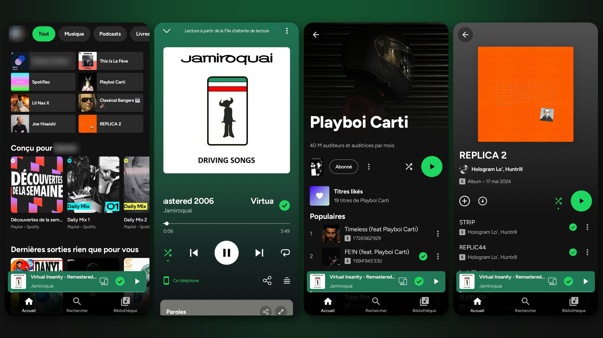
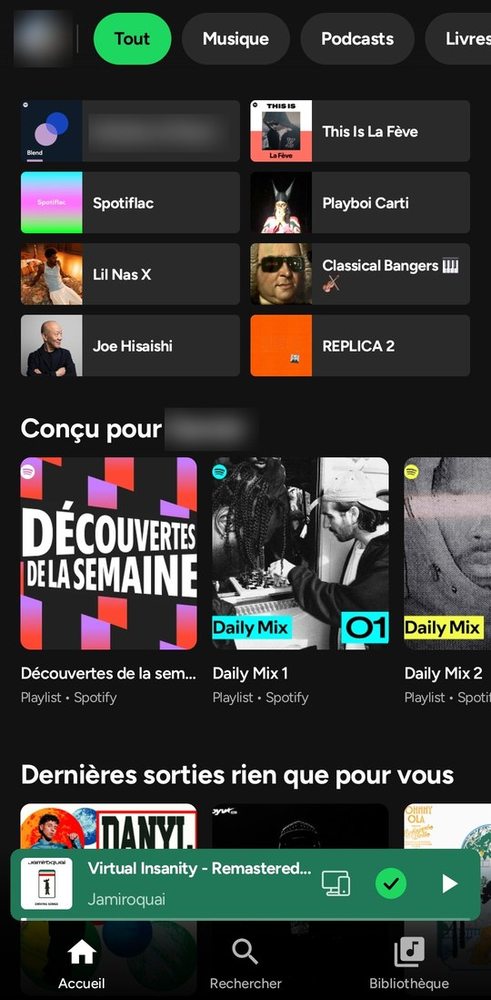
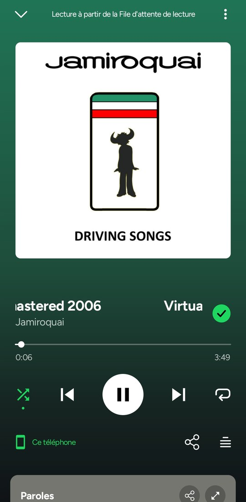
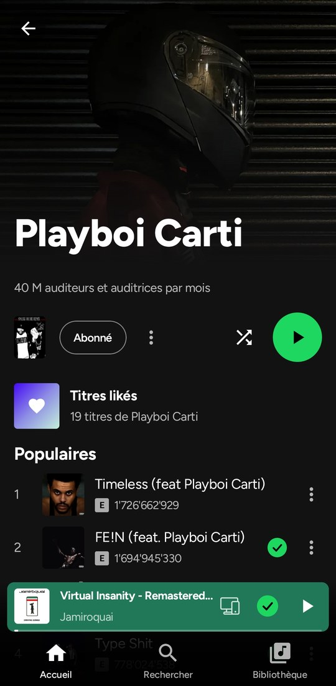
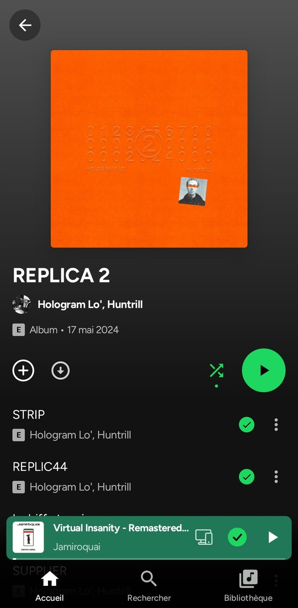

# NEXTFY

[](https://github.com/M17facanha2005/NEXTFY/releases/latest)
[](LICENSE)
[](https://discord.gg/jXKnGVFnGS)

**Spotify sem anúncios, em conta gratuita.** Sua própria conta do Spotify, playlists e Wrapped, num app nativo para Android que bloqueia anúncios, com downloads offline por extensões que você instala.

<p align="center">
  
</p>

<p align="center">
  <a href="https://github.com/M17facanha2005/NEXTFY/releases/latest"><b>⬇ Baixar o APK mais recente</b></a>
</p>

<p align="center">
  <a href="https://ko-fi.com/kotazo"></a>
  <a href="https://github.com/sponsors/M17facanha2005"></a>
</p>

## Por que NEXTFY

### 🚫 Spotify sem anúncios, em conta gratuita
Sem anúncios de áudio, sem anúncios de vídeo, sem banners e sem pausa de 30 segundos entre músicas. O NEXTFY desliga os blocos de anúncios do próprio player do Spotify, então uma conta gratuita funciona como Premium: escolha qualquer música, pule quantas quiser. Sem Premium, sem app do Spotify modificado, nada de root.

### ⬇️ Downloads offline, por extensões
O NEXTFY não tem fonte de download própria. Instale uma **extensão de fonte de download** (Configurações, Extensões) e você pode baixar uma música, um álbum, uma playlist ou todas as suas Curtidas, e ouvir sem conexão: no avião, no metrô, sem dados. A extensão decide de onde os arquivos vêm e em quais formatos (FLAC, M4A ou MP3); o NEXTFY os mantém criptografados no seu telefone, recusa um arquivo que não tem a duração da música e mantém as playlists baixadas sincronizadas: músicas que você adiciona no Spotify são baixadas sozinhas.

### ✨ E tudo o que você espera do Spotify, e mais
Sua home, busca, biblioteca, playlists, podcasts, Spotify Connect e Android Auto, além de **letras palavra por palavra**, **vídeos musicais oficiais** e **significados de músicas da Genius**.

## O que é?

O NEXTFY é um app do Spotify para Android que você mesmo instala. Você faz login com sua conta do Spotify, na própria página de login do Spotify: o NEXTFY nunca vê sua senha. Uma conta gratuita basta.

Por baixo dos panos, o próprio Web Player do Spotify toca a música, escondido dentro do app, com o DRM do seu telefone. O NEXTFY desenha suas próprias telas por cima e o controla. Suas reproduções são reportadas ao Spotify exatamente como num navegador: contam para os artistas, no seu histórico e no seu Wrapped.

## Começar

1. Baixe o APK da [última versão](https://github.com/M17facanha2005/NEXTFY/releases/latest) e abri-lo (Android 10 ou posterior). O Android pede uma vez para permitir instalações pelo seu navegador ou gerenciador de arquivos.
2. Toque em **Log in with Spotify** e faça login.
3. Escolha a qualidade de som, permita o que quiser (notificações, Bluetooth, arquivos locais…), e está dentro.

Novas versões são oferecidas dentro do app: um toque baixa e instala.

## O que você ganha

**Ouvindo**
- Sem anúncios (veja acima).
- Home, busca, Browse, Novos lançamentos, Sua Biblioteca com pastas, páginas de artista, álbum, playlist e perfil, com o próprio conteúdo do Spotify.
- Escolha qualquer música: aleatório, Smart Shuffle, fila (arraste para reordenar), repetir, crossfade, temporizador de sono.
- Podcasts e audiolivros, com seu próprio player (velocidade, ±15 s, marcar como ouvido).
- Spotify Connect, Jam, Bluetooth com o nome do seu fone, tela de bloqueio, notificação, widget e Android Auto.

**Letras e vídeos**
- Letras sincronizadas, palavra por palavra quando uma fonte tem o tempo (ou linha por linha, sua escolha nas Configurações), com tradução.
- **Significados de músicas da Genius**: uma lâmpada para a história da música, e um toque longo em uma linha sublinhada para sua explicação, traduzida para o seu idioma.
- **Vídeos musicais oficiais**, sincronizados com a música, em tela cheia se quiser. Reproduza-os silenciosamente sobre a música, ou ouça o som do próprio clipe enquanto a música continua contando no Spotify.

**Suas playlists**
- Crie, edite (nome, descrição, capa), ordene, torne pública, privada ou colaborativa.
- **Adicione músicas** de uma busca do Spotify dentro da playlist, com sugestões.
- **Playlists colaborativas**: convide amigos com um link, veja quem está dentro e quem adicionou cada música.
- Compartilhe qualquer música, álbum, artista ou playlist como um **Spotify Code** (scannável no app do Spotify) ou um link.

**Offline**
- Com uma extensão de fonte de download instalada: baixe músicas, álbuns, playlists e Curtidas, nos formatos que a extensão oferece (ou reencodados para AAC pequeno no telefone).
- Downloads são criptografados e ficam no NEXTFY. Listas que você baixou permanecem sincronizadas com o Spotify.
- Seus arquivos de áudio locais também.

**Extensões**
- Scripts escritos por outras pessoas, em sandbox: letras de outras fontes, de onde vem o áudio ou download de uma música, seções do Home, itens de menu, ferramentas que usam sua conta do Spotify.
- Ao instalar, mostra o que a extensão fará (cada ação com o motivo do autor, as críticas marcadas) e pede um tick: você instala por sua própria responsabilidade. Uma extensão recebe todas as ações que lista, ou não é instalada; uma atualização que pede mais aguarda seu OK e mostra apenas o que muda.
- Com uma extensão de fonte de áudio ligada, toda música que você toca (de uma lista, busca, artista, Recentes, um link ou aleatório) é perguntada primeiro lá, e toca no Spotify quando não tem nada.
- Para autores: [API de extensões](docs/extensions/API.md), e um runner de desktop para testar sem um telefone.

**E também**
- Seu recap: suas melhores músicas, artistas e álbuns, guardados no seu telefone.
- 10 idiomas: inglês, francês, alemão, espanhol, italiano, português, grego, russo, polonês e chinês (simplificado).
- Economizador de dados, economizador de bateria, preto AMOLED, cor de destaque.

## Novo desde 1.1

A versão 2.0 é um novo app, reconstruído do zero.

- 🚀 **Um novo engine**: telas mais rápidas, pulos mais rápidos, e reprodução que se recupera sozinha quando o player do Spotify falha.
- 🚫 **Anúncios parados na fonte** em vez de pulados.
- 🎧 **Downloads por extensões** em vez de áudio do YouTube integrado, criptografados no seu telefone.
- 🎤 **Letras palavra por palavra**, de mais fontes, com **significados de músicas da Genius**.
- 🎬 **Vídeos musicais com som próprio**, em tela cheia, em melhor qualidade.
- 👥 **Playlists colaborativas**, uma tela **Adicionar músicas**, e edição completa de playlists.
- 🔀 **Smart Shuffle**, uma fila arrastável, crossfade.
- 🎙️ **Podcasts e audiolivros** estão de volta, com seu próprio player e downloads.
- 📷 **Spotify Codes** para compartilhar, e perfis, Recentes, Browse e Novos lançamentos.
- 🌍 **Quatro novos idiomas**, atualizações no app e um relatório de diagnóstico que você envia com um toque.

Toda mudança está no [changelog](CHANGELOG.md).

## Screenshots

| Home | Player | Artista | Álbum |
|:---:|:---:|:---:|:---:|
|  |  |  |  |

## Perguntas

**É seguro para minha conta?** O NEXTFY fala com o Spotify como o web player faz, e você faz login na própria página do Spotify. Bloquear anúncios ainda é contra os Termos de Uso do Spotify (veja o aviso abaixo).

**"Spotify recusou tocar isso"?** Algumas contas novas ou gratuitas são recusadas pelo Spotify. Configurações → **Exportar um relatório de diagnóstico** e envie no [Discord](https://discord.gg/jXKnGVFnGS) ou em um [issue](https://github.com/M17facanha2005/NEXTFY/issues): ele tem o log recente do app (o que o Spotify respondeu) e o modelo do seu telefone, nunca sua senha ou tokens de login.

**Downloads contam no meu Wrapped?** Não. Músicas tocadas de um download não são reportadas ao Spotify; contam só no recap do NEXTFY. Músicas streamadas e vídeos musicais contam normalmente.

**O que sai do meu telefone?** Suas reproduções vão para o Spotify. Letras são buscadas em sites de letras, significados de músicas na Genius, traduções no Google Translate, vídeos musicais no YouTube, e downloads nos hosts que sua extensão de fonte de download nomeia (mostrados antes de você instalar). Nada é enviado ao desenvolvedor.

## Não incluído

- Sem circumvenção de DRM, e sem download de áudio do Spotify: músicas offline vêm da extensão de fonte de download que você instala, e uma música que ela não tem arquivo fica marcada como indisponível. O NEXTFY não vem com fonte de download própria.
- Nenhum anúncio é marcado como ouvido.

## Aviso legal

Bloquear anúncios vai contra os Termos de Uso do Spotify, e o Spotify pode suspender contas que o fazem. Use este app por sua conta e risco. Se puder, apoie os artistas com Premium ou comprando a música deles.

Não é afiliado ou endossado pelo Spotify. Spotify é uma marca registrada da Spotify AB.

## Suporte

O NEXTFY é gratuito, não tem anúncios e é feito no meu tempo livre. Se você gosta, pode apoiá-lo no [Ko-fi](https://ko-fi.com/kotazo) ou [GitHub Sponsors](https://github.com/sponsors/M17facanha2005), também em **Sobre** no app. Nada fica atrás de uma doação.

Notícias, ajuda e ideias: o [servidor do Discord](https://discord.gg/jXKnGVFnGS). Bugs e solicitações: [GitHub issues](https://github.com/M17facanha2005/NEXTFY/issues).

## Para desenvolvedores

O projeto Android está em `base/`, dividido em duas partes:

- **`:api`** é o contrato que a UI usa: modelos e interfaces Kotlin simples (player, busca, catálogo, biblioteca, playlists, home, podcasts, usuários, letras, dispositivos, Jam).
- **`:api-spotify`** implementa isso no Web Player do Spotify. A reprodução fica no player oficial, em um WebView oculto (`:host-android`), movido por um pequeno script de ponte. Catálogo, busca e biblioteca vão direto aos servidores do Spotify. Quando o Spotify lança um novo Web Player, o app lê a nova lista de operações sozinho.
- **`:host-cdp`** roda a mesma API no Chrome desktop, então toda a API é testada contra o Web Player real sem um telefone.

Mais: [`base/api-spotify/README.md`](base/api-spotify/README.md) e [`docs/api`](docs/api).

Requisitos: JDK 17+ e o Android SDK (compileSdk 37).

```bash
cd base
./gradlew assembleDebug
./gradlew testDebugUnitTest
```

Testes ao vivo da API (Chrome desktop com um Web Player com login):

```bash
google-chrome --user-data-dir="$HOME/.NEXTFY-chrome" --remote-debugging-port=9222
./gradlew :host-cdp:test -Pcdp=http://localhost:9222
```

Cada push constrói e testa no GitHub Actions. Uma tag `v*` publica um APK assinado em Releases.

## Créditos

- UI derivada de [Spotui](https://github.com/Spotui/Spotui) / [Metrolist](https://github.com/MetrolistGroup/Metrolist) (GPL-3.0); Spotui também deu a remux DASH-to-FLAC.
- A aparência Immersive (player, letras, fila, barra de abas de vidro e páginas) é portada de [BitChord](https://github.com/kushagrasinghx/BitChord) (GPL-3.0-or-later).
- [NewPipeExtractor](https://github.com/TeamNewPipe/NewPipeExtractor) (GPL-3.0): vídeos musicais.
- Letras: [LRCLIB](https://lrclib.net), LyricsPlus, lrc.red, Kugou e NetEase; significados de músicas: [Genius](https://genius.com).
- [Material Icons](https://github.com/google/material-design-icons) (Apache 2.0) e a fonte [Manrope](https://github.com/googlefonts/manrope) (SIL OFL 1.1, veja `base/licenses/`).

Notas completas: [`THIRD_PARTY_NOTICES.md`](THIRD_PARTY_NOTICES.md).

## Licença

GPL-3.0. Se você reutilizar este código, deve creditar o NEXTFY, manter os avisos de licença e publicar seu código completo sob GPL-3.0. Cópias de código fechado ou sem crédito são violações e serão reportadas à plataforma de hospedagem (remoção por DMCA). Veja também [`AGENTS.md`](AGENTS.md).
